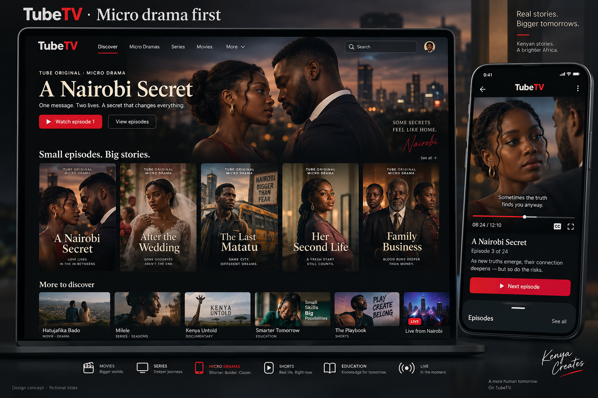

# TubeTV visual direction

Generated with the built-in image-generation tool. This is a concept with fictional titles, not a screenshot of the implemented site. The image's displayed runtime is illustrative; pilot episode-length experiments should be measured separately.

## Exact generation prompt

Use case: ui-mockup. Generate a polished high fidelity visual concept for TubeTV, a Kenyan streaming platform launching vertical micro dramas while retaining movies, series, shorts, education and live. A wide product design presentation showing a large desktop homepage and one realistic mobile screen beside it. Cinematic charcoal black, warm ivory typography, TubeTV scarlet accent, exceptional editorial spacing. Desktop top navigation: TubeTV, Discover, Micro Dramas, Series, Movies, More, Search. Hero features fictional Kenyan Black actors in a tense romance in contemporary Nairobi, title 'A Nairobi Secret', eyebrow 'TUBE ORIGINAL · MICRO DRAMA', short synopsis 'One message. Two lives. A secret that changes everything.', buttons 'Watch episode 1' and 'View episodes'. Beneath hero an elegant shelf 'Small episodes. Big stories.' with five tall 9:16 drama posters with fictional titles and Black Kenyan actors: 'A Nairobi Secret', 'After the Wedding', 'The Last Matatu', 'Her Second Life', 'Family Business'. Secondary lower shelf 'More to discover' with landscape movies and education thumbnails. Mobile screen shows a portrait episode player with compact episode title, 'Episode 3 of 24', synopsis, captions control, and 'Next episode', with a clear Episodes drawer handle. Attractive realistic UI mockup, legible text, refined and credible streaming product not a busy dashboard, no payment pricing premium padlocks coins or subscriptions. Label the presentation 'TubeTV · Micro drama first' and small 'Design concept · fictional titles'. The image is a proposed direction, not a screenshot of a shipped implementation.
